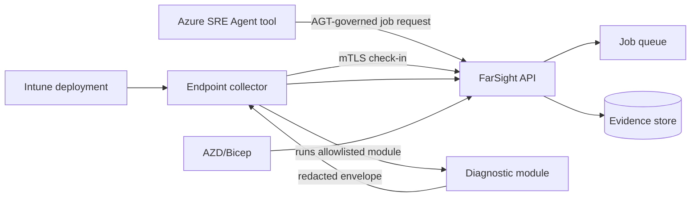

# Architecture

FarSight collects read-only endpoint diagnostic evidence through allowlisted modules and exposes job orchestration to approved Azure SRE Agent tools.

The architecture is in early implementation. Diagrams document the intended V1 direction; resource names and some deployment assets will be finalized as AZD/Bicep infrastructure matures.

## Documents

- [Architecture diagrams](architecture-diagrams.md)
- [Regional topology](regional-topology.md)
- [Data flows](data-flows.md)
- [Trust boundaries](trust-boundaries.md)
- [Decision records](decisions.md)

## Component overview

## Deployment model

- Infra is deployed via AZD/Bicep.
- The collector is deployed via Intune.
- Azure SRE Agent integration is exposed through governed tools and AGT policy.

## Known gaps

- Link final OpenAPI document when published.
- Add production resource names after deployment decisions are approved.
