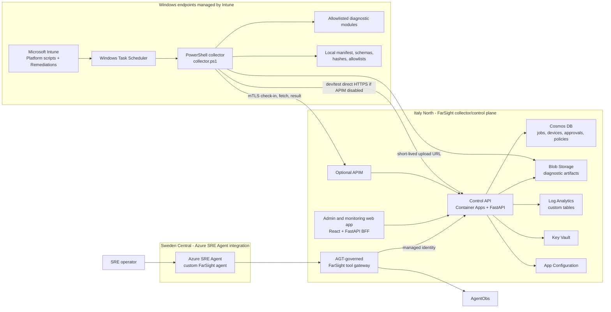
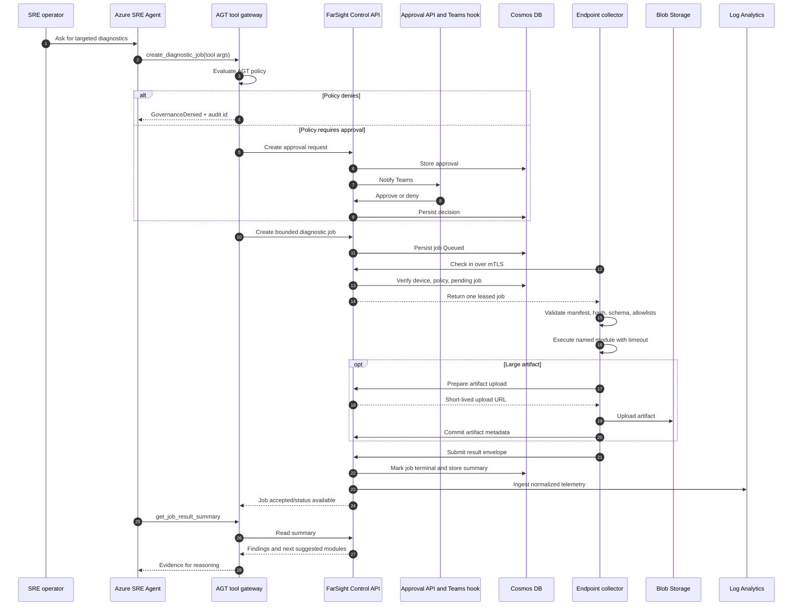
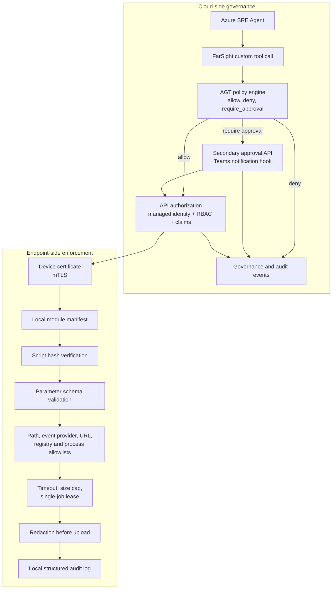
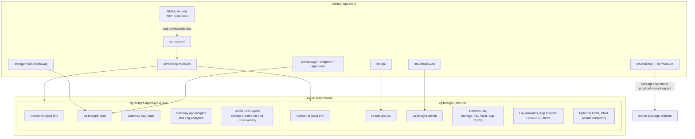
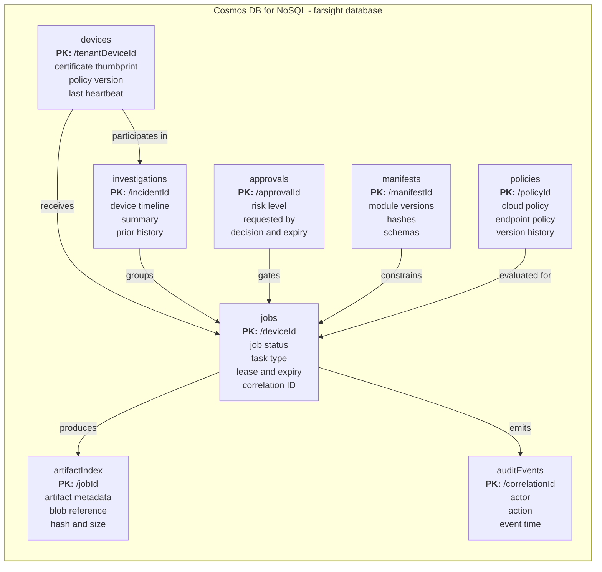
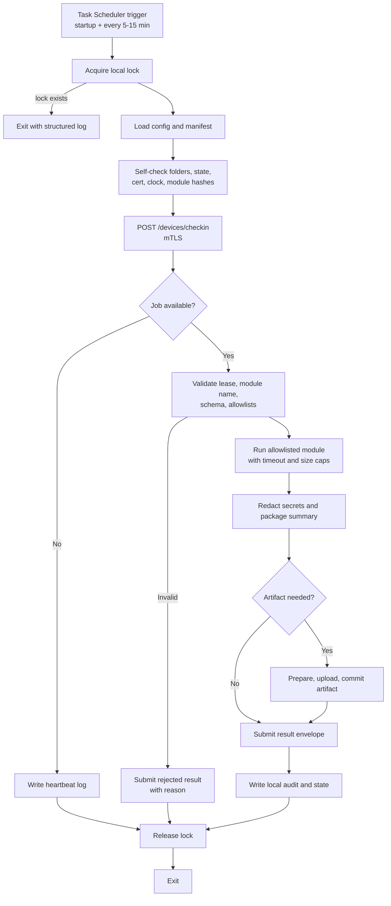
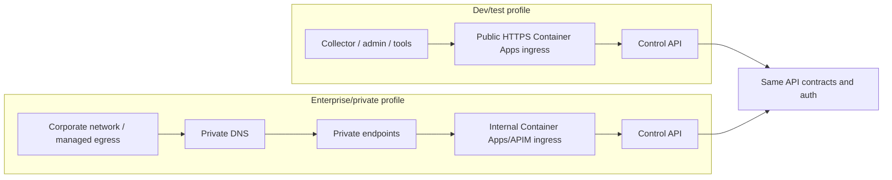

# Agent-Azure-FarSight Architecture Diagrams

Generated: 2026-06-12

These diagrams document the intended Agent-Azure-FarSight V1 architecture during early implementation.

## 1. High-level regional architecture

## 2. Diagnostic job lifecycle

## 3. Dual-control security model

## 4. Azure deployment topology

## 5. Cosmos DB state model

## 6. Endpoint collector execution model

## 7. Public-dev versus private-prod ingress

